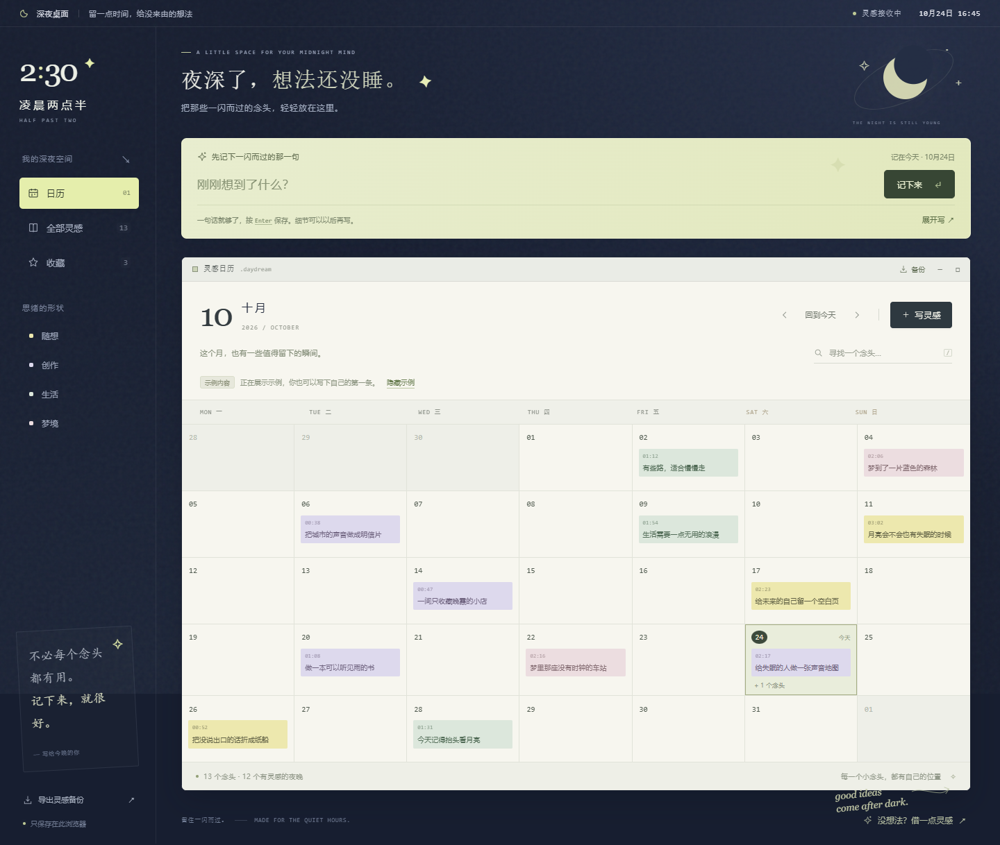

# 凌晨两点半 · Half Past Two

一个收留深夜灵感的日历工具，用层叠便签记录、整理和收藏一闪而过的念头，让每个想法都有自己的位置。



当前版本 **1.1.0**。原生 HTML、CSS、JavaScript，零第三方运行依赖，支持阿里云 **ESA Pages + 边缘函数**。

- GitHub：<https://github.com/Foulereee/half-past-two>（私有仓库）
- 本地项目：`D:\esa\trae`
- [使用说明](使用说明.md)
- [阿里云 ESA 部署说明](阿里云ESA部署说明.md)

## 开始使用

需要 Node.js 20 或更高版本。双击根目录的 `打开原型.bat`，或运行：

```powershell
cd D:\esa\trae
npm run dev
```

打开 <http://127.0.0.1:4173>。无需执行 `npm install`。如果端口被占用，可以使用正在运行的预览，或用 `$env:PORT=4174; npm run dev` 启动其他端口。

## 记录，只要一步

1. 在页面上方写一句话，按 Enter 即可保存到今天。
2. 点日历里的日期回看当晚灵感；空白日期可以直接开始写。
3. 想多写一点，点“展开写”或“写灵感”。分类、日期和心情收在选填项里。

关闭编辑窗口会保留草稿，点“继续草稿”即可接着写。删除后可在提示条里撤销。日历、灵感列表和编辑便签保留层叠窗口设计，支持拖动和键盘操作。

## 还可以做什么

- 搜索标题、正文、分类和日期；按 `/` 聚焦搜索，按 `N` 新建，Ctrl/⌘ + Enter 保存。
- 按分类或收藏筛选，清除筛选后回到月历。
- 显示或隐藏示例内容；写下第一条自己的灵感后默认隐藏示例。
- 导出包含灵感和草稿的 JSON 备份；导入时合并数据、跳过相同内容，不覆盖已有记录。
- 通过“借一点灵感”获得一个写作问题；请求失败时自动使用内置问题。
- 手机端保留文字导航、备份入口和更大的操作区域。

## 数据放在哪里

已保存的灵感和自动保存的草稿放在当前浏览器的 localStorage 中。不会上传灵感正文，无账号或跨设备同步。清除浏览器数据会移除这些内容。

本地预览地址、不同端口、ESA 测试域名和自定义域名各自使用独立的数据空间。迁移前通过“备份 → 导出全部灵感”下载 JSON，再在新地址“备份 → 导入备份文件”。

## 构建与检查

```powershell
npm run check
npm run build
```

构建生成 `dist/`。GitHub 保存源码与文档；`dist/`、临时截图、备份与 ZIP 不提交，ESA 会在部署时重新构建。

配置位于根目录 `esa.jsonc`：构建命令 `npm run build`、静态目录 `./dist`、函数入口 `./functions/index.js`、SPA 导航回退 `singlePageApplication`。

边缘函数只使用标准 Web API，不依赖 Node.js 文件系统、数据库或第三方服务：

- `GET /api/prompt`：随机写作问题。
- `GET /api/health`：版本和服务状态。
- 两者支持 HEAD；未知接口返回 404，其他方法返回 405。

## 项目目录

```text
public/                    前端源码和图标
functions/index.js         ESA 边缘函数
scripts/                   本地预览、构建与检查脚本
docs/images/               产品预览图
dist/                      本地生成的静态部署文件
esa.jsonc                  ESA 构建和路由配置
github-repository.json     仓库地址与分支
打开原型.bat               Windows 本地启动入口
使用说明.md                面向使用者的操作说明
阿里云ESA部署说明.md       从 GitHub 到 ESA 的部署步骤
```

## 验证

已通过代码语法、配置与 API 检查，以及真实 Edge 浏览器的桌面与手机操作检查，覆盖快速记录、草稿恢复、导入去重、删除撤销、搜索收藏、窗口拖动、接口与离线回退。

可选浏览器检查使用 `scripts/browser-qa.mjs`，需要另行提供 Playwright 和 Edge；这是开发检查工具，产品本身没有该依赖。先启动预览，再运行 `node scripts/browser-qa.mjs`。Playwright 在其他目录时，将 `PLAYWRIGHT_MODULE` 设置为其绝对路径。

当前已提供 ESA 兼容实现和部署配置，尚未登录阿里云账号发布。部署后可按独立部署说明逐项验收。
